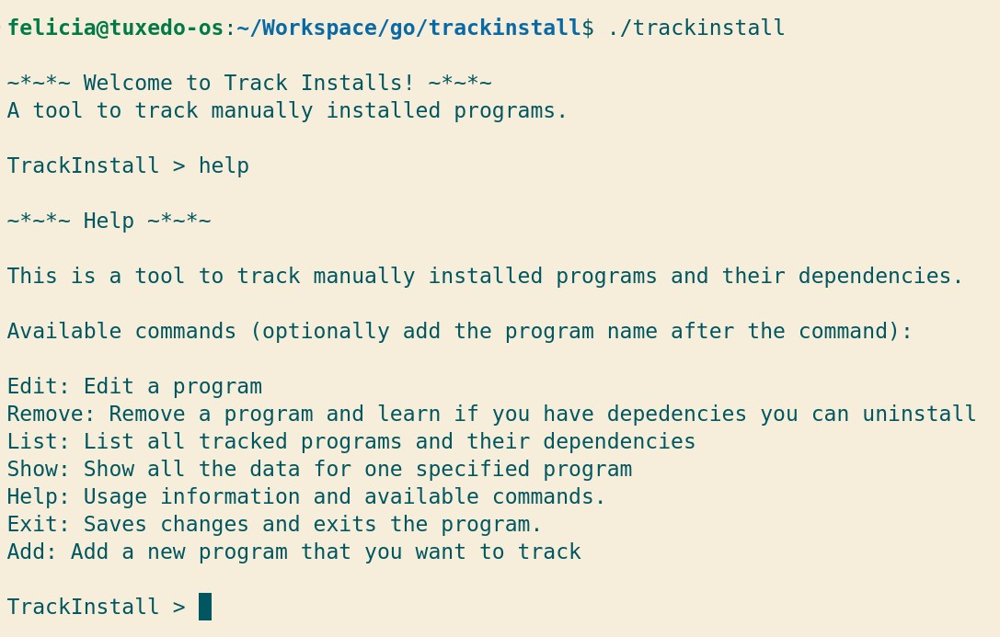
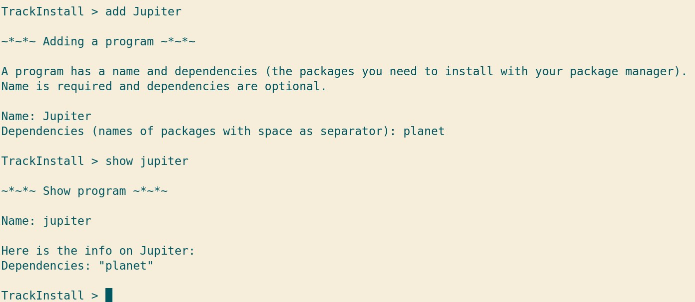
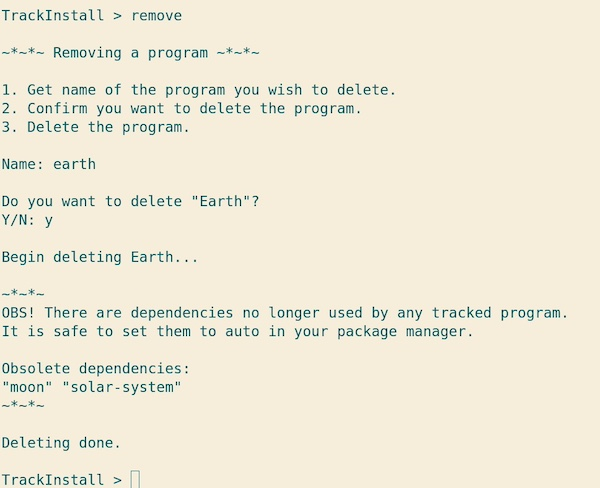

# TrackInstall :ledger:

A CLI tool to track manually installed programs/apps and their dependencies written in Go.

Have trouble keeping track of the packages you manually install with your package manager? Do you want to avoid your OS slowly bloating due to them? TrackInstall is the place you can save this information so that you know when you can move those packages to auto so your package manager can work its magic.

In a future update, you will be able to add installation steps as well as uninstallation steps, so you can track folders and other files to delete when uninstalling a manually installed program.

This project's initial MVP was completed during [boot.dev's](https://boot.dev) hackathon in [July 2025](https://blog.boot.dev/news/hackathon-2025/). I created this tool because I wanted it myself.

## Usage

Install the project by:
```
git clone https://github.com/FeliciaFredlund/trackinstall
```

Run it (from inside the project folder):
```
go build
./trackinstall
```

For the Hackathon there is an example folder that has a sample data file with some fake programs added. To use it as your data file, put in this command before starting it:
```
mv example/EXAMPLE-ti_data.json ti_data.json 
```

## Screenshots
Opening screen as well as what the help command looks like:



Adding a program and the show command that shows a chosen program:



What deleting a program looks like:



## Changelog

Version 0 - 2025-07-27

## Future Plans

### New Additions Planned
1. Be able to fix capitalization mistakes in names of projects if the name is exactly the same otherwise. (bug fix)
2. Add/edit/remove installation and uninstallation instructions.
3. Add the option to overwrite an existing program while adding/editing a program.
4. Add the option to pick the path and filename for the data file. This should also allow placing the binary file wherever.
5. Add what package manager is used, and add the option to have the tool give the commands for installing dependencies and removing/changing them to auto when no longer needed.
6. List dependencies and what programs are dependent on them.
7. Add the option to exit out of adding/editing/removing mode at any point, saving/not saving changes where applicable.
8. Add short versions of commands: ls for list, rm for remove.
9. Change help command so it prints the commands in the same order every time.
10. Add the option of encrypting the data file, unlocking it with a password/key or similar.

### Refactor Ideas
- newProgram also adds the program to the map of programs, meaning that have to be sent in too. (This is to avoid inconsistency in how program names as keys get processed. But I still need to remember to strings.ToLower any time I check the map)
- The depedency struct should hold a slice of *program instead of a slice of programNames
- Change edit function so the switch statement use Go const iota or change it some other way
- Divide files. Aka break up command file perhaps to put each command in their own file, and have the main command file have the helper functions